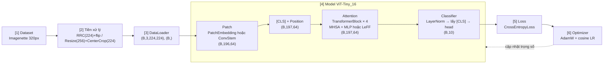

# Ghi chú kiến trúc — ViT-Tiny_16 trên Imagenette

Tài liệu này giải thích **kiến trúc trong code**: dữ liệu đi qua những khối nào, mỗi khối nằm ở file nào, tensor có shape gì ở từng bước, vì sao chọn thiết kế đó, và hai cải tiến **Convolutional Stem** (locality ở đầu vào) và **LeFF** (locality trong mỗi Transformer block) thay đổi gì so với bản gốc.

---

## 1. Luồng dữ liệu tổng thể



`train.py` ([run_training](train.py#L27)) chỉ khởi tạo và nối các bước trên theo đúng thứ tự `[1] → [6]`; không bước nào tự đọc hyperparameter, tất cả đều nhận từ [configs/config.yaml](configs/config.yaml).

## 2. Cấu trúc thư mục — mỗi file một trách nhiệm

| Đường dẫn | Trách nhiệm duy nhất |
|---|---|
| [configs/config.yaml](configs/config.yaml) | **Nơi duy nhất** chứa giá trị hyperparameter |
| [configs/config.py](configs/config.py) | Schema dataclass (chỉ tên + kiểu, không có giá trị mặc định); đọc YAML, kiểm tra thiếu/thừa khoá, áp override `--set` |
| [datasets/imagenette.py](datasets/imagenette.py) | Tải Imagenette, augmentation/chuẩn hoá, tạo DataLoader |
| [models/components.py](models/components.py) | Các khối Lego: `PatchEmbedding`, `ConvStem`, `ClsTokenPositionEmbedding`, `MultiHeadSelfAttention`, `MLP`, `LocalityFeedForward`, `TransformerBlock`, `ClassifierHead` |
| [models/vit.py](models/vit.py) | Class `ViT` chỉ sắp xếp các khối; `build_stem` / `build_mlp` / `build_block` chọn khối theo config; `build_model(cfg)` |
| [utils/optim.py](utils/optim.py) | Dựng loss, optimizer, LR scheduler từ config |
| [utils/engine.py](utils/engine.py) | `train_one_epoch`, `evaluate` |
| [utils/metrics.py](utils/metrics.py) | accuracy top-k, `AverageMeter`, confusion matrix |
| [utils/logger.py](utils/logger.py) | Log ra màn hình + file, ghi `history.csv/json` |
| [utils/checkpoint.py](utils/checkpoint.py) | Lưu/nạp checkpoint |
| [utils/attention.py](utils/attention.py) | Attention của [CLS]: last-layer và Attention Rollout |
| [utils/visualize.py](utils/visualize.py) | Vẽ đường cong, overlay attention, confusion matrix |
| [utils/shapes.py](utils/shapes.py) | In bảng shape qua từng module (kiểm chứng hợp đồng shape) |
| [utils/architecture.py](utils/architecture.py) | Vẽ sơ đồ so sánh kiến trúc, sinh tự động từ model (shape thật, số tham số thật) |
| [train.py](train.py) | Khởi tạo mọi thứ + vòng lặp huấn luyện |
| [eval.py](eval.py) | Chỉ đánh giá checkpoint trên tập test |
| [visualize_attention.py](visualize_attention.py) | Chồng attention map của [CLS] lên ảnh val; so sánh nhiều model trên cùng ảnh |
| [ViT_Tiny_16.ipynb](ViT_Tiny_16.ipynb) | Notebook nộp bài: chạy toàn bộ quy trình, lưu log, hình và phần thảo luận |

## 3. Hợp đồng shape (bản gốc, stem = `linear`)

Ký hiệu: B = batch (32), N = 196 patch, T = 197 token, D = 64, h = 4 head, Dh = 16, F = 128, K = 10.

| Bước | Khối (file) | Vào | Ra |
|---|---|---|---|
| Tiền xử lý | `build_transforms` | ảnh PIL cạnh ngắn 320 | `(3, 224, 224)` |
| DataLoader | `build_dataloaders` | — | ảnh `(B, 3, 224, 224)`, nhãn `(B,)` |
| Cắt patch | `PatchEmbedding` reshape/permute | `(B, 3, 224, 224)` | `(B, 196, 768)` |
| Chiếu patch | `PatchEmbedding.proj` = `nn.Linear(768, 64)` | `(B, 196, 768)` | `(B, 196, 64)` |
| Nối [CLS] | `ClsTokenPositionEmbedding` | `(B, 196, 64)` | `(B, 197, 64)` |
| + Position | `nn.Embedding(197, 64)` tra theo `0..196` | `(197,)` | `(197, 64)` → cộng broadcast |
| Q, K, V | `MultiHeadSelfAttention.qkv` | `(B, 197, 64)` | `(B, 197, 192)` → 3 × `(B, 4, 197, 16)` |
| Attention | `softmax(QKᵀ/√16)` | — | `(B, 4, 197, 197)` |
| Gộp head | `attn @ V` → `proj` | `(B, 4, 197, 16)` | `(B, 197, 64)` |
| MLP | `Linear(64,128) → GELU → Linear(128,64)` | `(B, 197, 64)` | `(B, 197, 64)` |
| 4 block | `TransformerBlock × 4` | `(B, 197, 64)` | `(B, 197, 64)` |
| Lấy [CLS] | `ViT.forward`: `norm(x)[:, 0]` | `(B, 197, 64)` | `(B, 64)` |
| Phân loại | `ClassifierHead` | `(B, 64)` | logits `(B, 10)` |
| Loss | `CrossEntropyLoss` | `(B, 10)`, `(B,)` | số vô hướng |

Bảng này được **kiểm chứng tự động** mỗi lần chạy: `train.py` gọi `trace_shapes` và in bảng shape thật vào đầu `train_log.txt`. Các khối còn kiểm tra shape đầu vào và báo lỗi bằng thông điệp rõ ràng (ví dụ ảnh không phải 224×224, `embed_dim` không chia hết cho `num_heads`, số patch không khớp bảng position).

## 4. Chi tiết từng khối

### 4.1 Tokenization — [PatchEmbedding](models/components.py#L26)

Đây là đúng nghĩa đen của "An Image is Worth **16x16 Words**": ảnh 224×224 được cắt thành lưới 14×14 = 196 patch, mỗi patch 16×16×3 = 768 giá trị, rồi đi qua một `nn.Linear(768, 64)` dùng chung cho mọi patch.

Việc cắt patch chỉ dùng `reshape` + `permute`, không copy dữ liệu theo vòng lặp:

```text
(B, C, H, W) = (B, 3, 224, 224)
  reshape  -> (B, 3, 14, 16, 14, 16)     # H = 14 lưới × 16 điểm ảnh, W tương tự
  permute  -> (B, 14, 14, 3, 16, 16)     # (hàng lưới, cột lưới, nội dung patch)
  reshape  -> (B, 196, 768)              # patch thứ k = hàng (k // 14), cột (k % 14)
```

Thứ tự patch là **theo hàng** (row-major): patch `k` nằm ở hàng `k // 14`, cột `k % 14`. Thứ tự này đã được kiểm tra bằng test (so patch `3·14+7` với lát cắt `img[:, 48:64, 112:128]`), và chính quy ước này giúp đưa vector attention `(196,)` về lại lưới `14×14` khi vẽ heatmap.

Cách viết này tương đương toán học với `Conv2d(3, 64, kernel_size=16, stride=16)`. Code dùng `nn.Linear` vì đề bài yêu cầu và vì nó cho thấy rõ "patch = một từ".

### 4.2 Position — [ClsTokenPositionEmbedding](models/components.py#L104)

- **[CLS]**: một vector học được `(1, 1, 64)`, nối vào **đầu** chuỗi. Token này không thuộc patch nào; qua các lớp attention, nó gom thông tin từ mọi patch, và đầu ra của nó là đại diện cho cả ảnh khi phân loại.
- **Position embedding**: bảng tham số học được `nn.Embedding(197, 64)`, tra theo chỉ số `0..196` (0 = [CLS], 1..196 = patch theo thứ tự hàng). Self-attention là phép toán **bất biến hoán vị**: nếu không cộng position, model không phân biệt được patch ở góc trái trên với patch ở giữa ảnh. Bảng 197 × 64 = 12,608 tham số được khởi tạo `trunc_normal(std=0.02)` và học từ đầu.
- Chỉ số vị trí `0..196` được giữ trong một buffer không lưu vào checkpoint (`persistent=False`), nên tự động chuyển cùng thiết bị với model.

### 4.3 Attention — [MultiHeadSelfAttention](models/components.py#L135)

Attention được **tự cài đặt** (đề bài cho phép dùng `nn.TransformerEncoderLayer`, nhưng yêu cầu thiết kế module hoá cần một class `MultiHeadSelfAttention` riêng, và tự cài đặt cũng giúp lấy được ma trận attention để trực quan hoá):

```text
qkv  = Linear(64, 192)(x)                     (B, 197, 192)
q,k,v = tách thành 4 head                      mỗi cái (B, 4, 197, 16)
attn = softmax(q · kᵀ / √16)                   (B, 4, 197, 197)   mỗi hàng cộng = 1
out  = attn · v  → gộp head → Linear(64, 64)   (B, 197, 64)
```

Có hai đường tính toán cho **cùng một phép toán**:
- Mặc định (khi train): `F.scaled_dot_product_attention`, kernel tối ưu của PyTorch, nhanh hơn.
- Khi `save_attention = True`: tính tường minh và giữ lại `attention_map (B, h, T, T)`. Context manager [`ViT.capture_attention()`](models/vit.py#L89) bật cờ này cho mọi layer.

Đã kiểm tra hai đường cho ra logits lệch nhau tối đa ~1e-7.

### 4.4 [TransformerBlock](models/components.py#L246) — kiểu pre-norm

```text
x = x + MHSA(LayerNorm(x))
x = x + FFN(LayerNorm(x))        FFN = MLP: 64 → 128 → GELU → 64   (hoặc LeFF, §5.2)
```

`TransformerBlock` chỉ lo cấu trúc **norm + residual**; khối attention và khối feed-forward được dựng sẵn rồi truyền vào (`build_block` trong [models/vit.py](models/vit.py#L40)). Đổi MLP sang LeFF vì vậy không cần sửa class block.

Pre-norm (LayerNorm đặt **trước** sub-layer, như ViT gốc) giữ cho nhánh residual là một đường đi thẳng, giúp gradient ổn định khi train from scratch, kể cả khi không có learning-rate warmup dài. Shape vào bằng shape ra `(B, 197, 64)` nên các block có thể xếp chồng tuỳ ý (`depth = 4`).

### 4.5 Classifier — [ViT.forward](models/vit.py#L83) + [ClassifierHead](models/components.py#L273)

Sau 4 block: `LayerNorm` cuối → lấy vector ở vị trí 0 (token [CLS]) → `ClassifierHead`. Với `head_hidden: 0` (mặc định) head là `Linear(64, 10)` như "MLP head" của ViT gốc khi fine-tune; đặt `head_hidden > 0` để có head 2 lớp `Linear → GELU → Linear`.

### 4.6 Khởi tạo — [ViT._init_weights](models/vit.py#L58)

Toàn bộ trọng số được khởi tạo ngẫu nhiên: `Linear`, [CLS] và position dùng `trunc_normal(std=0.02)`, bias = 0, LayerNorm (1, 0), `Conv2d` dùng Kaiming. **Không có bất kỳ trọng số pretrained nào**: dự án không import `timm`, HuggingFace hay `torchvision.models`.

### 4.7 Số tham số

| Khối | linear + MLP (gốc) | linear + LeFF | conv + MLP | conv + LeFF |
|---|---:|---:|---:|---:|
| stem | 49,216 | 49,216 | 80,088 | 80,088 |
| [CLS] + position | 12,672 | 12,672 | 12,672 | 12,672 |
| 4 × TransformerBlock | 133,888 | 139,008 | 133,888 | 139,008 |
| LayerNorm cuối | 128 | 128 | 128 | 128 |
| head | 650 | 650 | 650 | 650 |
| **Tổng** | **196,554** | **201,674** | **227,426** | **232,546** |

Mỗi block: 33,472 tham số với MLP, 34,752 với LeFF (+1,280 của DWConv 3×3).

Chi phí tính toán xấp xỉ mỗi ảnh: phần Transformer ~46M MAC (cả hai bản); stem `linear` ~10M MAC, stem `conv` ~71M MAC.

## 5. Cải tiến

Cả hai cải tiến đều nhắm vào cùng một điểm yếu: ViT thuần **không có inductive bias cục bộ**, trong khi Imagenette chỉ có ~9.5k ảnh train để tự học điều đó. Hình so sánh hai kiến trúc (sinh bằng [utils/architecture.py](utils/architecture.py)) được lưu ở `outputs/architecture_comparison.png` và hiển thị trong notebook mục 14.

### 5.1 Convolutional Stem — [ConvStem](models/components.py#L59)

**Vấn đề của patch + Linear.**

Bước "patchify" là một phép chiếu tuyến tính với kernel **16×16, stride 16**: một bước nhảy rất lớn, không chồng lấn, không có phi tuyến. Các nghiên cứu đã chỉ ra đây là nguyên nhân chính khiến ViT khó tối ưu, nhạy với lr/optimizer, và **cần rất nhiều dữ liệu**: model phải tự học từ đầu cả các đặc trưng cục bộ (cạnh, kết cấu) mà CNN có sẵn nhờ inductive bias. Imagenette chỉ có ~9.5k ảnh train, nên đây đúng là điểm yếu.

**Thiết kế.** Theo Xiao et al., 2021 — *Early Convolutions Help Transformers See Better*: thay patchify bằng một chồng conv 3×3 stride 2 nhỏ.

```text
(B, 3, 224, 224)
  Conv3x3 s2 → BN → ReLU   (B, 24, 112, 112)
  Conv3x3 s2 → BN → ReLU   (B, 48,  56,  56)
  Conv3x3 s2 → BN → ReLU   (B, 64,  28,  28)
  Conv3x3 s2 → BN → ReLU   (B, 64,  14,  14)
  Conv1x1                  (B, 64,  14,  14)
  flatten + transpose      (B, 196, 64)
```

- 4 lần stride 2 → giảm 2⁴ = 16 lần, **đúng bằng patch size**, nên vẫn ra lưới 14×14 = 196 token. Vì vậy position embedding, [CLS], 4 block và head **giữ nguyên hoàn toàn**: đổi stem là thay đúng một viên Lego (`model.stem: conv`). Code tự kiểm tra `2^len(channels) == patch_size`.
- Conv chồng lấn + BatchNorm + ReLU đưa vào **inductive bias cục bộ** và tính phi tuyến ngay từ đầu; mỗi token có receptive field rộng hơn và mượt hơn thay vì một ô 16×16 cứng.
- Kênh `[24, 48, 64, 64]` được chọn nhỏ để tổng tham số chỉ tăng ~31k (+16%). Như vậy khi so sánh, phần lớn cải thiện đến từ inductive bias chứ không phải từ việc model to hơn.

### 5.2 Locality trong mỗi block: LeFF — [LocalityFeedForward](models/components.py#L201)

**Vấn đề còn lại.** Conv Stem chỉ thêm tính cục bộ ở **đầu vào**. Trong 4 TransformerBlock, attention là toàn cục và MLP xử lý từng token riêng lẻ, nên quan hệ "patch cạnh nhau" vẫn phải học từ dữ liệu ở mọi layer.

**Thiết kế.** Theo CeiT (Yuan et al., 2021) và LocalViT (Li et al., 2021): chèn một **depthwise conv 3×3** vào giữa `fc1` và `fc2` của MLP.

```text
x (B, 197, 64)
  fc1: Linear 64→128                    (B, 197, 128)
  tách:  [CLS] (B, 1, 128)  |  patch (B, 196, 128)
  patch → xếp lưới (row-major, §4.1)    (B, 128, 14, 14)
  DWConv 3×3, padding 1, groups=128     (B, 128, 14, 14)
  duỗi + nối lại [CLS]                  (B, 197, 128)
  GELU → fc2: Linear 128→64             (B, 197, 64)
```

- **Giữ đúng đề bài:** D = 64, 4 head, 4 layer, MLP hidden = 128 không đổi; chỉ thêm 128·9 + 128 = **1,280 tham số mỗi block** (+5,120, +2.6%).
- **[CLS] đi thẳng**: token này không có vị trí trên lưới nên không qua conv.
- **Depthwise** (`groups = 128`): mỗi kênh ẩn có kernel 3×3 riêng, chỉ trộn **không gian**; việc trộn **kênh** vẫn do `fc1`/`fc2` đảm nhiệm. Vì vậy chi phí rất nhỏ (128 × 196 × 9 ≈ 0.23M MAC mỗi block).
- **Kiểm chứng:** đổi một patch đầu vào thì với MLP chỉ token đó đổi theo, còn với LeFF đúng 3×3 = 9 token láng giềng đổi theo và [CLS] không đổi (notebook mục 11). Phép thử này cũng xác nhận phép xếp lưới dùng đúng thứ tự patch.
- Shape vào = shape ra = `(B, T, D)` nên LeFF thay thẳng cho MLP; bật bằng `model.mlp_type: leff`, kernel đặt bởi `model.leff_kernel_size`. Checkpoint cũ (MLP) vẫn nạp được vì tên tham số `fc1`, `fc2` giữ nguyên.

### 5.3 Ablation 2×2

Để tách riêng tác dụng của từng cải tiến, notebook huấn luyện 4 cấu hình với **cùng config, cùng seed, 20 epoch**:

| | MLP | LeFF |
|---|---|---|
| **stem linear** | `vit_tiny_16` (bản gốc) | `vit_tiny_16_leff` |
| **ConvStem** | `vit_tiny_16_convstem` | `vit_tiny_16_convstem_leff` |

Kết quả (best val top-1, một seed mỗi cấu hình; sai số chuẩn của phép đo ≈ ±0.7 điểm):

| | MLP | LeFF | Δ LeFF |
|---|---:|---:|---:|
| **stem linear** | 63.77% | 63.87% | +0.10 |
| **ConvStem** | **78.24%** | 77.73% | −0.51 |
| **Δ ConvStem** | +14.47 | +13.86 | |

ConvStem mang lại cải thiện rõ rệt; LeFF không cải thiện đo được trong 20 epoch. Phân tích chi tiết nằm ở notebook mục 15–18.

## 6. Huấn luyện

| Tham số | Giá trị | Ghi chú |
|---|---|---|
| batch_size | 32 | theo đề bài |
| optimizer | AdamW, lr = 3e-4, betas (0.9, 0.999) | theo đề bài |
| epochs | 20 | đề bài 15–20 |
| loss | `CrossEntropyLoss` | theo đề bài |
| weight_decay | 0.05 | *bổ sung*; không áp cho bias, norm, [CLS], position |
| LR schedule | warmup 2 epoch → cosine về 1e-6 | *bổ sung*; đặt `scheduler.name: none` để giữ lr cố định |
| label_smoothing | 0.1 | *bổ sung*; vẫn là `CrossEntropyLoss`, chống overconfident trên dữ liệu nhỏ |
| grad_clip | 1.0 | *bổ sung*; ổn định đầu quá trình train |
| dropout | 0.1 | *bổ sung* |
| RandomResizedCrop scale | (0.35, 1.0) | mặc định (0.08, 1.0) quá mạnh cho model nhỏ, dữ liệu ít |
| RandomHorizontalFlip | p = 0.5 | *bổ sung*; augmentation chuẩn |

Mọi mục *bổ sung* đều nằm trong `config.yaml` và có thể tắt mà không sửa code.

Bốn run trong notebook dùng **cùng một config**, chỉ khác `model.stem` và `model.mlp_type`, để so sánh công bằng.

## 7. Trực quan hoá attention của [CLS] — [utils/attention.py](utils/attention.py)

- **last_layer**: lấy hàng [CLS] (`attn[:, 0, 1:]`, 196 giá trị) của layer cuối, trung bình qua 4 head, reshape về lưới 14×14 (theo đúng thứ tự patch row-major ở §4.1), phóng bilinear lên 224×224 rồi chồng lên ảnh.
- **rollout** (Abnar & Zuidema, 2020): attention ở một layer chỉ cho biết token trộn với token nào **ở layer đó**. Rollout nhân dồn ma trận `0.5·A + 0.5·I` (thành phần `I` mô phỏng kết nối residual) qua cả 4 layer, nên phản ánh tốt hơn thông tin từ patch nào thực sự chảy về [CLS].

## 8. Bằng chứng huấn luyện from scratch

- Không có dòng code nào nạp trọng số từ nguồn ngoài; `load_checkpoint` chỉ dùng cho checkpoint do chính `train.py` sinh ra.
- `train.eval_before_training: true`: trước epoch 1, model vừa khởi tạo được đánh giá trên tập val và ghi vào log dưới dạng **epoch 0**; kỳ vọng loss ≈ ln(10) ≈ 2.30 và accuracy ≈ 10%.
- Loss của **iteration 1** được in riêng; sau đó cứ mỗi 50 iteration in một lần.
- `outputs/<run>/train_log.txt`, `history.csv` và đường cong trong notebook cho thấy loss giảm dần, accuracy tăng dần theo epoch.
