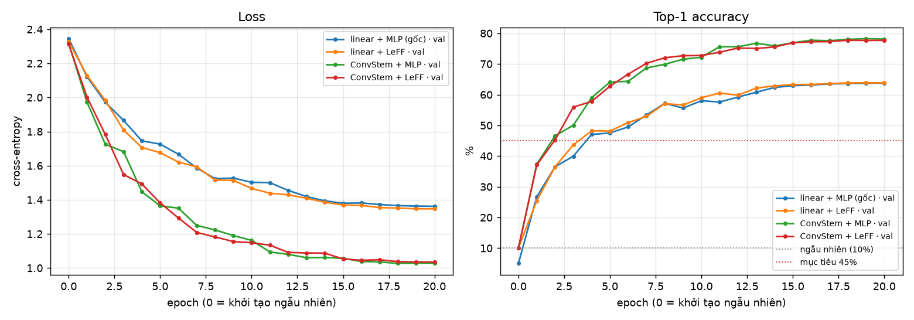
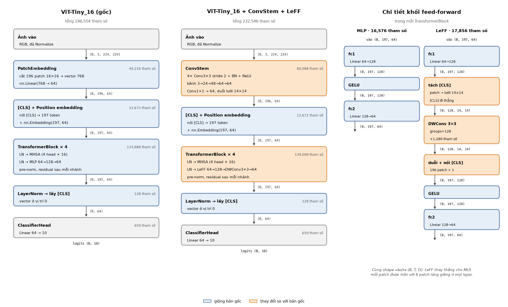
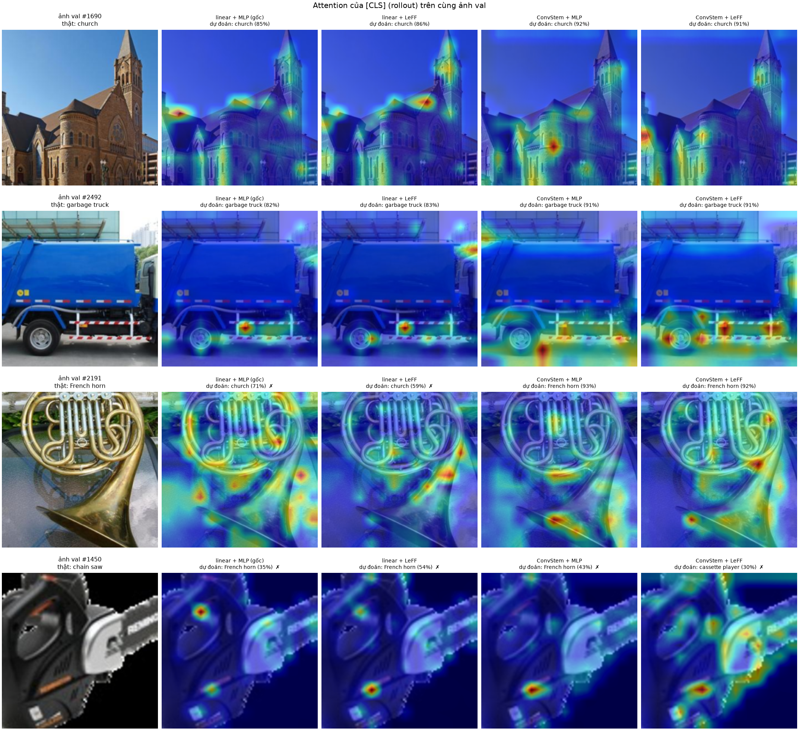
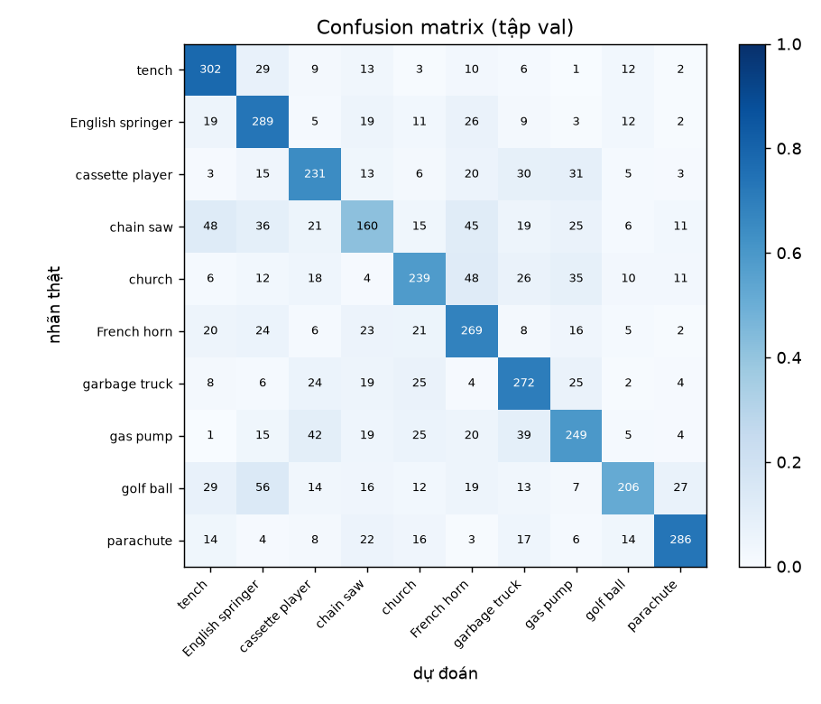
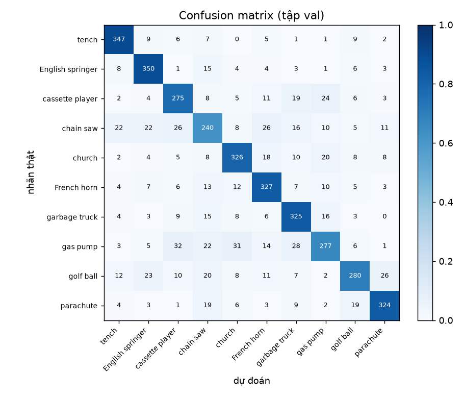
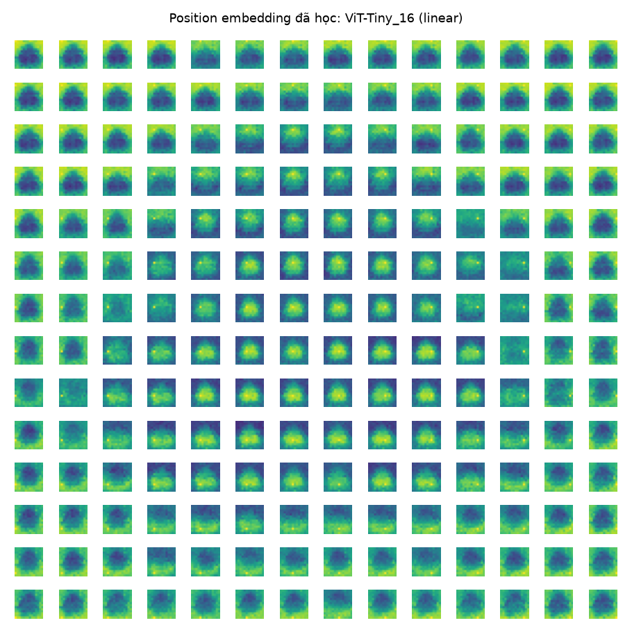
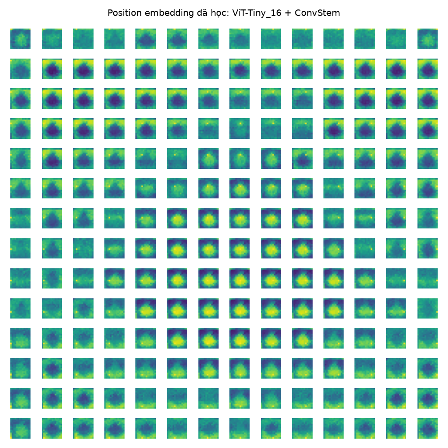

# ViT-Tiny_16 from scratch trên Imagenette

Vision Transformer nhỏ (embed 64, 4 head, 4 layer, MLP 128, patch 16×16, ~197k tham số) được huấn luyện **từ khởi tạo ngẫu nhiên, không dùng bất kỳ trọng số pretrained nào**, trên [Imagenette](https://github.com/fastai/imagenette) (10 lớp, 9,469 ảnh train / 3,925 ảnh val). Dự án gồm bản gốc, hai cải tiến **Convolutional Stem** và **LeFF** (depthwise conv 3×3 trong MLP của mỗi block), một ablation 2×2 và trực quan hoá attention của token [CLS].

| | |
|---|---|
| Notebook đầy đủ (log huấn luyện, đường cong, attention map, thảo luận) | [ViT_Tiny_16.ipynb](ViT_Tiny_16.ipynb) |
| Ghi chú kiến trúc (luồng dữ liệu, hợp đồng shape, lý do thiết kế) | [ARCHITECTURE.md](ARCHITECTURE.md) |

## Kết quả

Cả 4 cấu hình dùng **cùng config, cùng seed, 20 epoch** (batch 32, AdamW lr 3e-4, CrossEntropyLoss), huấn luyện trên CPU.

| Cấu hình | Tham số | Best val top-1 | Top-5 | Vượt 45% từ epoch |
|---|---:|---:|---:|---:|
| linear + MLP (**bản gốc**, ViT-Tiny_16) | 196,554 | 63.77% | 94.09% | 4 |
| linear + LeFF | 201,674 | 63.87% | 94.60% | 4 |
| **ConvStem + MLP** | 227,426 | **78.24%** | 97.43% | 2 |
| ConvStem + LeFF | 232,546 | 77.73% | 97.55% | 2 |

Ngẫu nhiên = 10%; yêu cầu của bài tập là > 45%.

**Ablation 2×2** (best val top-1, %):

| | MLP | LeFF | Δ LeFF |
|---|---:|---:|---:|
| **stem linear** | 63.77 | 63.87 | +0.10 |
| **ConvStem** | 78.24 | 77.73 | −0.51 |
| **Δ ConvStem** | +14.47 | +13.86 | |

- **ConvStem** là cải tiến hiệu quả: **+14.5 điểm**, tốt hơn ở cả 10 lớp, và chỉ sau 5 epoch đã bằng bản gốc sau 20 epoch.
- **LeFF** không cải thiện đo được: chênh lệch ±0.5 điểm nhỏ hơn sai số chuẩn của phép đo (≈ ±0.7 điểm trên 3,925 ảnh, một seed mỗi cấu hình).
- **Huấn luyện from scratch:** ở epoch 0 (chưa cập nhật trọng số), cả 4 model có val loss 2.31–2.35 ≈ ln(10) và accuracy 5–10%, đúng mức đoán ngẫu nhiên.

### Đường cong huấn luyện



Epoch 0 là model vừa khởi tạo ngẫu nhiên. Hai cấu hình ConvStem tách hẳn khỏi hai cấu hình stem linear ngay từ những epoch đầu; trong mỗi cặp, đường MLP và LeFF gần như trùng nhau.

### So sánh kiến trúc: bản gốc vs ConvStem + LeFF



Sơ đồ được sinh tự động từ chính hai model ([utils/architecture.py](utils/architecture.py)): shape lấy từ một lần forward thật, số tham số đếm từ module. Khối màu cam là khối thay đổi so với bản gốc.

- **ConvStem** thay bước cắt patch + `nn.Linear` bằng 4 conv 3×3 stride 2 (+BN+ReLU) và một conv 1×1. Nó vẫn tạo đúng lưới 14×14 = 196 token, nên phần còn lại của model giữ nguyên.
- **LeFF** chèn một depthwise conv 3×3 giữa `fc1` và `fc2` trong MLP, trên lưới 14×14 của các patch token; [CLS] đi thẳng qua. Mỗi block chỉ thêm 1,280 tham số.

### Attention của token [CLS]



Attention Rollout của cả 4 model trên cùng 4 ảnh val; ✗ đánh dấu dự đoán sai. Ảnh được chọn theo dự đoán của hai run đầu, **trước khi** huấn luyện hai run LeFF: hai ảnh cả hai model đều đúng (church, garbage truck), một ảnh chỉ ConvStem đúng (French horn), một ảnh cả hai đều sai (chain saw).

Ở ảnh French horn, hai model stem linear đoán nhầm thành "church" và attention tản ra nền; hai model ConvStem đoán đúng (92–93%) và tập trung vào miệng loa và ống đồng.

### Accuracy theo lớp

| Lớp | linear + MLP | linear + LeFF | ConvStem + MLP | ConvStem + LeFF |
|---|---:|---:|---:|---:|
| tench | 78.0% | 78.6% | 89.7% | 91.0% |
| English springer | 73.2% | 70.6% | 88.6% | 87.1% |
| cassette player | 64.7% | 66.7% | 77.0% | 77.6% |
| chain saw | 41.5% | 42.2% | 62.2% | 59.8% |
| church | 58.4% | 59.4% | 79.7% | 76.3% |
| French horn | 68.3% | 66.2% | 83.0% | 82.0% |
| garbage truck | 69.9% | 71.0% | 83.5% | 84.3% |
| gas pump | 59.4% | 59.4% | 66.1% | 65.6% |
| golf ball | 51.6% | 51.4% | 70.2% | 75.4% |
| parachute | 73.3% | 74.1% | 83.1% | 79.0% |
| **Tổng** | **63.77%** | **63.87%** | **78.24%** | **77.73%** |

<details>
<summary>Confusion matrix và position embedding đã học</summary>

**Confusion matrix:** bản gốc (trái) và ConvStem + MLP (phải)

<p>


</p>

**Position embedding đã học** (cosine similarity giữa các vị trí): bản gốc (trái) và ConvStem (phải). Từ một bảng `nn.Embedding(197, 64)` khởi tạo ngẫu nhiên, model tự học được cấu trúc không gian dạng "trung tâm so với rìa".

<p>


</p>

</details>

Phân tích đầy đủ (vì sao ~64% là mức bình thường cho bản gốc, vì sao ConvStem hiệu quả, các giả thuyết vì sao LeFF chưa giúp được) nằm ở **mục 18** của notebook.

## Cấu trúc dự án

```text
configs/config.yaml      # nơi DUY NHẤT chứa hyperparameter
configs/config.py        # đọc YAML thành dataclass có kiểu, báo lỗi khi thiếu/thừa khoá
datasets/imagenette.py   # Dataset → tiền xử lý → DataLoader
models/components.py     # PatchEmbedding, ConvStem, ClsTokenPositionEmbedding,
                         # MultiHeadSelfAttention, MLP, LocalityFeedForward,
                         # TransformerBlock, ClassifierHead
models/vit.py            # ViT chỉ ghép các khối; build_stem / build_mlp chọn khối theo config
utils/                   # accuracy, logging, checkpoint, optimizer/scheduler,
                         # vòng lặp train/eval, attention, vẽ hình
train.py                 # khởi tạo mọi thứ + vòng lặp huấn luyện
eval.py                  # chỉ đánh giá checkpoint trên tập test
visualize_attention.py   # attention map của [CLS], một hoặc nhiều model
```

## Cài đặt

```bash
pip install -r requirements.txt
```

Lần chạy đầu sẽ tự tải Imagenette 320px (~340 MB) vào `data/`.

## Chạy

Mọi hyperparameter nằm trong [configs/config.yaml](configs/config.yaml). Có thể sửa file đó hoặc ghi đè bằng `--set`:

```bash
# Bản gốc: patch 16x16 + nn.Linear
python train.py

# Cải tiến 1: Convolutional Stem
python train.py --set model.stem=conv experiment.name=vit_tiny_16_convstem

# Cải tiến 2: LeFF (locality trong mỗi block), có / không ConvStem
python train.py --set model.mlp_type=leff experiment.name=vit_tiny_16_leff
python train.py --set model.stem=conv model.mlp_type=leff experiment.name=vit_tiny_16_convstem_leff

# Đánh giá trên tập test (split val của Imagenette)
python eval.py --run outputs/vit_tiny_16_convstem

# Attention map của [CLS]: một run, hoặc nhiều run trên cùng ảnh
python visualize_attention.py --run outputs/vit_tiny_16_convstem
python visualize_attention.py --run outputs/vit_tiny_16 outputs/vit_tiny_16_convstem --indices 1690 2191
```

Mỗi run ghi vào `outputs/<experiment.name>/`: `config.yaml` (snapshot), `train_log.txt`, `history.csv/json`, `best.pt`, `last.pt`, rồi `eval.json`, `confusion_matrix.png`, `attention_cls.png`. Trên CPU 24 luồng, mỗi epoch mất khoảng 1 phút với stem linear và 1.5 phút với ConvStem.
